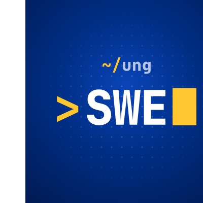
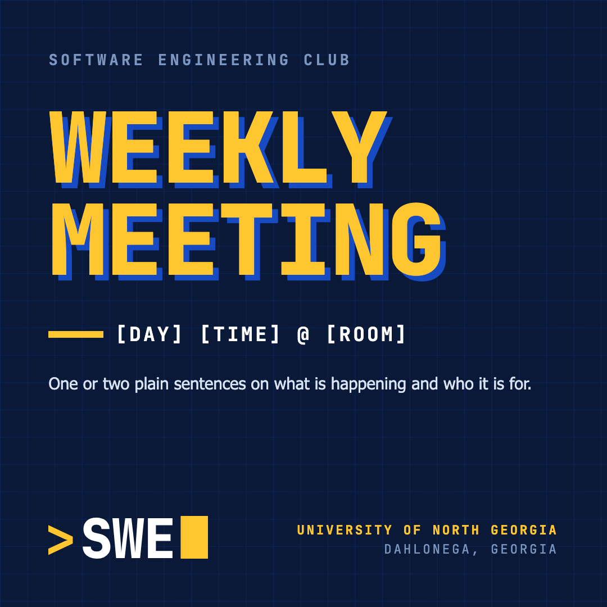

<p align="center">
  
</p>

# SWE Club Styling Guide

How the UNG Software Engineering Club looks and sounds: flyers, social posts, slides, websites, and repos. If you are making something with the club's name on it, start here.

The short version: **a terminal at UNG.** UNG Blue and Gold, monospace type, a prompt and a cursor, square corners, hard shadows.

## What's in this repo

| Path | What it is |
| --- | --- |
| [`assets/logo/`](assets/logo) | The mark as SVG and PNG, plus transparent lockups |
| [`assets/palette.svg`](assets/palette.svg) | The palette as an image |
| [`tokens/swe.css`](tokens/swe.css) | Colors, fonts, and a few shared building blocks as CSS |
| [`templates/event-banner.html`](templates/event-banner.html) | 16:9 banner for slides, Discord, and UNG Connect |
| [`templates/social-square.html`](templates/social-square.html) | 1:1 post for Instagram |
| [`assets/examples/`](assets/examples) | Rendered previews of the templates |

## Logo

The mark is a terminal prompt: a gold chevron, `SWE` in white, and a gold block cursor, under the path `~/ung`.

| File | Use it for |
| --- | --- |
| `swe-mark.svg`, `swe-mark-1024.png`, `swe-mark-400.png` | Profile pictures and anywhere the logo stands alone. Square; platforms crop it to a circle. |
| `swe-prompt.svg` | White and gold `>SWE▮` with no background, for blue and navy surfaces |
| `swe-prompt-white.svg` | One-color white, for photos and single-color print on dark |
| `swe-prompt-blue.svg` | One-color UNG Blue, for light backgrounds and single-color print |

<p>
  
</p>

**Rules**

- Leave clear space on every side at least as wide as the cursor block.
- Minimum size: 48 px for the square mark, 24 px tall for the prompt lockup.
- On a light background, use the square mark or the one-color blue lockup. Gold on white or cream is 1.6:1 or less and disappears.
- In the square mark, everything sits inside the central 70% so the circle crop never clips it. Keep it that way if you build a variant.
- Don't recolor it, stretch it, add effects, swap the typeface, or rebuild it from live text. The SVGs are outlined, so they render the same everywhere.

## Color


| Name | Hex | Token | Role |
| --- | --- | --- | --- |
| UNG Blue | `#002F87` | `--swe-blue` | Primary. The logo background, panels, light-mode text. PMS 287C. |
| UNG Gold | `#FFC62F` | `--swe-gold` | Accent. Titles, the chevron and cursor, buttons, rules. PMS 123C. |
| Navy | `#0A1938` | `--swe-navy` | Darkest surface for flyers and sites. Text on gold and cream. |
| Blue Deep | `#001A52` | `--swe-blue-deep` | Outer edge of the blue gradient |
| Blue Lift | `#0A44B8` | `--swe-blue-lift` | Centre of the blue gradient |
| Cobalt | `#164BC4` | `--swe-cobalt` | Hard shadows, grid lines, title bars. Never text on navy. |
| Cream | `#F3EEDF` | `--swe-cream` | Body text on dark, warm light surfaces |
| Soft | `#DBE4F5` | `--swe-soft` | Secondary text on dark |
| Steel | `#7D96BF` | `--swe-steel` | Kickers, captions, and borders on navy |

**Proportions.** Blue and navy carry the piece. Gold is the accent: one title, one rule, one button. If everything is gold, nothing is.

**Tested pairings** (WCAG contrast ratio; 4.5:1 is the floor for body text, 3:1 for large text)

| Text | Background | Ratio | Use |
| --- | --- | --- | --- |
| White | UNG Blue | 12.0:1 | Anything |
| Gold | UNG Blue | 7.6:1 | Anything |
| Cream | Navy | 15.0:1 | Anything |
| Soft | Navy | 13.6:1 | Anything |
| Gold | Navy | 11.1:1 | Anything |
| Steel | Navy | 5.8:1 | Small labels are fine |
| Steel | UNG Blue | 4.0:1 | Large text only |
| Navy | Gold | 11.1:1 | Buttons |
| UNG Blue | White or Cream | 12.0:1 / 10.3:1 | Anything |
| Gold | White or Cream | 1.6:1 / 1.4:1 | Never |
| Cobalt | Navy | 2.4:1 | Decoration only |

## Typography

| Role | Typeface | Notes |
| --- | --- | --- |
| Logo, titles, kickers, labels, buttons | **JetBrains Mono**, 700 and 800 | Free under the OFL from [Google Fonts](https://fonts.google.com/specimen/JetBrains+Mono) or [JetBrains](https://www.jetbrains.com/lp/mono/) |
| Fallback monospace | Courier New, bold | When you can't load a font: email, or sites that ship no font files |
| Body copy | Tahoma, Verdana, then the system sans | Paragraphs only. Keep it plain. |

```css
--swe-mono: "JetBrains Mono", ui-monospace, "Courier New", monospace;
--swe-sans: Tahoma, Verdana, system-ui, sans-serif;
```

**How to set it**

| Element | Weight | Case | Letter-spacing |
| --- | --- | --- | --- |
| Display title | 800 | UPPERCASE | −0.02em |
| Lowercase wordmark or heading | 700 | lowercase or sentence | −0.06em |
| Kicker, label, caption | 700 | UPPERCASE | +0.13em to +0.2em |
| Button | 700 | Sentence | 0 |
| Body | 400 | Sentence | 0, line-height 1.7 |

Big monospace gets tighter; small uppercase monospace gets wider. Body text is never monospace for more than a line or two, and never below 13 px on screen.

## Graphic elements

- **The prompt.** A gold `>` before a word, and a gold block cursor after it. Use it once per piece, usually through the logo.
- **Paths and separators.** `~/ung` for place, `//` between labels (`UNG // DAHLONEGA`), `@` for where (`OCT 24TH @ MCCB`).
- **Grids.** A faint cobalt line grid on navy, or a faint white dot grid on blue. They sit behind everything and should be barely visible.
- **Hard shadows.** Offset down and right in cobalt, with no blur: `4px 4px 0`. Titles, buttons, and panels get one. Nothing gets a soft drop shadow or a glow.
- **Square corners.** No rounded rectangles.
- **Window panels.** A framed box with a title bar and a gold rule under it, for a logo, illustration, or schedule.
- **Gold rules.** A short thick gold bar leading into a tagline, or a thin one under a title bar.
- **Pixel art.** For event illustrations, drawn on a visible grid in the club palette. See Hacklonega below.

## Voice

Write like a commit message: short, specific, present tense.

- Lead with what it is and when. `HACK THE MOUNTAINS. OCT 24TH @ MCCB.`
- Short imperative sentences beat adjectives. "Team up and build something" over "an exciting opportunity to collaborate."
- Terminal flavor in the furniture (kickers, labels, separators), plain English in the sentences people need to act on. Never hide the date, place, or sign-up link inside a joke.
- Say who it's for. Most events are open to every major and every skill level; when that's true, say so.
- Name the club as **Software Engineering Club** on first mention, **SWE** after.

## Flyers and social

| Format | Size | Template |
| --- | --- | --- |
| Slides, Discord, UNG Connect banner | 1920 × 1080 | `templates/event-banner.html` |
| Instagram post | 1080 × 1080 | `templates/social-square.html` |
| Link preview (Open Graph) | 1200 × 630 | Adapt the banner |
| Profile picture | 1024 × 1024 | `assets/logo/swe-mark-1024.png` |


<p>
  
</p>

**Anatomy,** top to bottom:

1. **Kicker**: who or what kind of event, small uppercase Steel
2. **Title**: the biggest thing on the page, gold with a cobalt hard shadow, at most two lines
3. **Tagline**: gold rule, then when and where in white
4. **Details**: one or two plain sentences, only if needed
5. **Sign-off**: University of North Georgia in gold, Dahlonega, Georgia in Steel, and the logo

**Using the templates.** Open the HTML file in a browser, edit the text in `<body>`, and export a PNG:

```sh
"/Applications/Google Chrome.app/Contents/MacOS/Google Chrome" --headless=new \
  --hide-scrollbars --virtual-time-budget=6000 \
  --window-size=1920,1080 --screenshot=banner.png templates/event-banner.html
```

Use `--window-size=1080,1080` for the square. If a title is too long, lower `--title-size` on the `<h1>` instead of adding a third line.

Working in Canva or Figma instead? Use the hex values above, install JetBrains Mono, and import the SVGs from `assets/logo/`.

## Event sub-brands

A big event can have its own name and artwork. [Hacklonega](https://github.com/Israel-Jauregui/Hacklonega) is the reference: a pixel-block wordmark and a pixel-art Dahlonega steeple, on the same navy, gold, and cobalt.

| An event may change | An event keeps |
| --- | --- |
| The title lettering (pixel type, a custom wordmark) | The palette |
| Its own illustration and favicon | Monospace kickers and labels, `//` and `@` |
| A tagline and tone of its own | Hard shadows, square corners, grid backgrounds |
| | The sign-off: University of North Georgia, Dahlonega, Georgia |

## Websites and repos

Link `tokens/swe.css` or copy the `:root` block. Then, following the Hacklonega site:

- Navy or blue page, cream text, gold for links that matter and for the one main button
- `:focus-visible { outline: 3px solid var(--swe-gold); outline-offset: 5px; }` and a gold `::selection`
- Tap targets at least 44 px tall
- Respect `prefers-reduced-motion`; a blinking cursor counts as motion
- An SVG favicon, a `theme-color`, and a 1200 × 630 Open Graph image in the club palette
- Alt text on every image, and a `<title>` and `<desc>` inside meaningful SVGs
- A `docs/ASSET-PROVENANCE.md` listing where every image, font, and logo came from and whether we may use it

## Using other people's marks

This guide covers the club's own identity. The club is a student organization, not the university: don't put UNG's official logos, seal, or athletics marks on club material unless the university has approved it. The same goes for sponsor and partner logos such as MLH. Use only artwork they supplied, unaltered.

## Changing this guide

Open a pull request. If you change a color or the logo, update `tokens/swe.css`, the palette image, and the tables here in the same PR so they never disagree.
