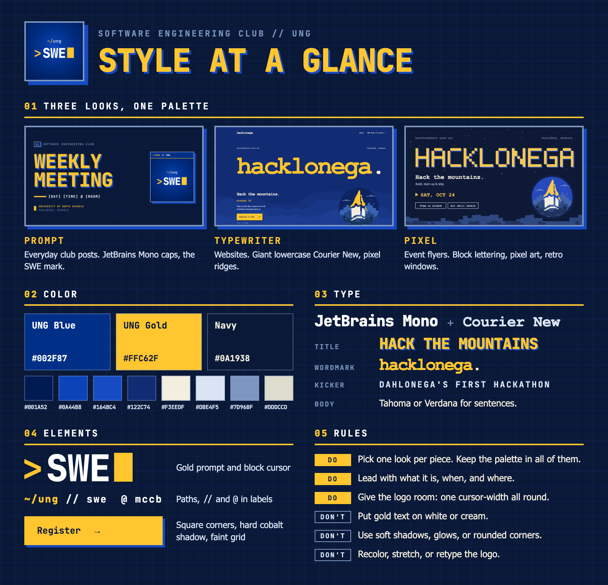
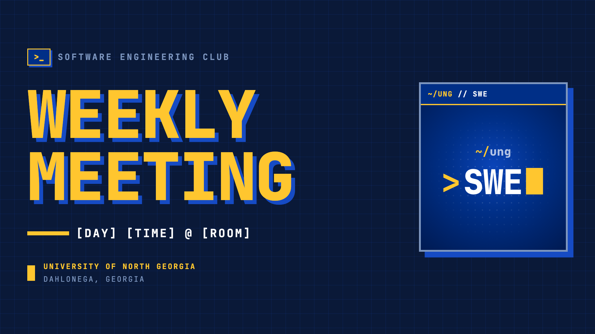
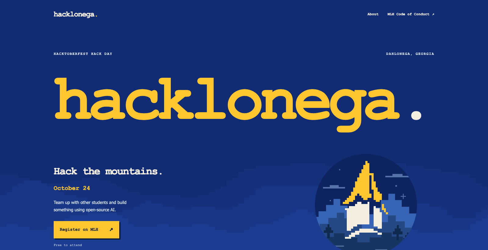
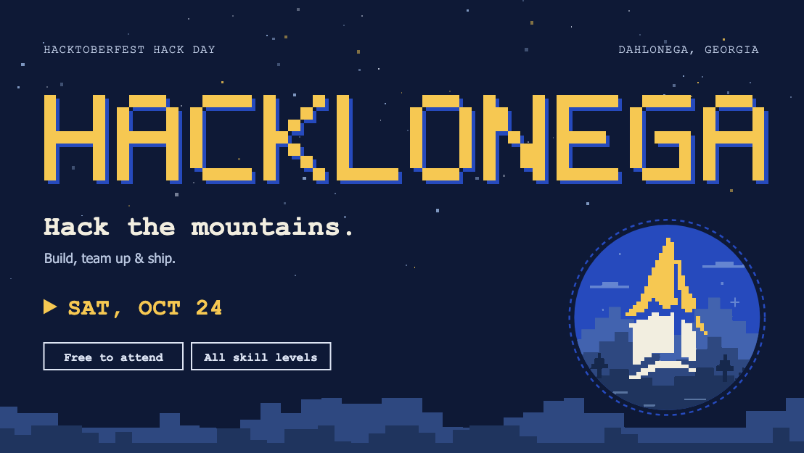
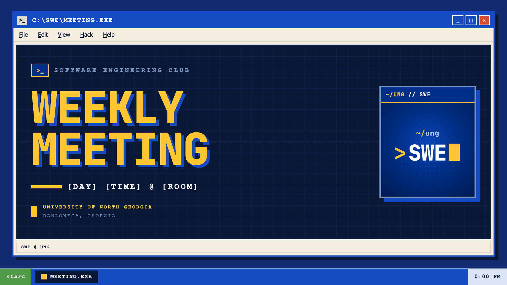
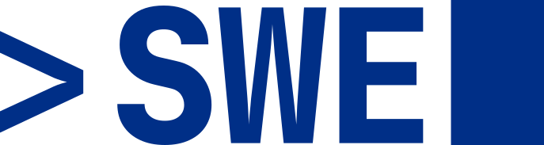
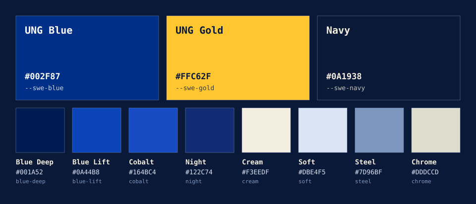

<p align="center">
  
</p>

# SWE Club Styling Guide

How the UNG Software Engineering Club looks and sounds: flyers, social posts, slides, websites, and repos. If you are making something with the club's name on it, start here.

The short version: **old computers at UNG.** Blue and gold, monospace type, pixels, square corners, hard shadows. Inside that, there are three looks to choose from.

## At a glance



That image is the whole guide on one page. Save it, pin it in Discord, and read on only when you need the details.

## What's in this repo

| Path | What it is |
| --- | --- |
| [`assets/logo/`](assets/logo) | The mark as SVG and PNG, plus transparent lockups |
| [`assets/at-a-glance.png`](assets/at-a-glance.png) | The one-page summary above (source: `assets/at-a-glance.html`) |
| [`assets/palette.svg`](assets/palette.svg) | The palette as an image |
| [`tokens/swe.css`](tokens/swe.css) | Colors, fonts, and a few shared building blocks as CSS |
| [`templates/event-banner.html`](templates/event-banner.html) | Prompt look, 16:9, for slides, Discord, and UNG Connect |
| [`templates/social-square.html`](templates/social-square.html) | Prompt look, 1:1, for Instagram |
| [`templates/window-flyer.html`](templates/window-flyer.html) | Retro desktop window, 16:9, for event flyers |
| [`assets/examples/`](assets/examples) | Template previews and real Hacklonega pieces |

## Three looks, one system

We don't have one layout. We have a palette and a set of habits, and three looks built from them. Pick one look per piece and commit to it.

### Prompt



The club's own voice. Uppercase JetBrains Mono in gold with a cobalt hard shadow, a faint grid on navy, and the `>SWE▮` mark in a window panel. Use it for weekly meetings, announcements, slides, and anything that isn't a named event.

### Typewriter



The look of [hacklonega.dev](https://hacklonega.dev). One giant lowercase word in bold Courier New, gold, ending in a cream full stop. A brighter Night blue page with pixel mountain ridges along the bottom and one piece of pixel art in a circle. Taglines are sentence case. Use it for websites and anything people scroll.

### Pixel



The look of the Hacklonega flyers. The title is drawn in pixel blocks on a 5 × 7 grid, gold with a cobalt offset. Navy background with a line grid or a pixel starfield, pixel art in a circle or a window panel, uppercase Courier New labels with wide tracking. Use it for event flyers and posters.

A Pixel flyer can sit inside a **retro desktop window**: a cobalt title bar with a file path (`C:\CODEHAWKS\HACKLONEGA.EXE`), a cream menu bar, a status bar, and a taskbar with a start button and a clock set to the event's start time. `templates/window-flyer.html` gives you the frame:



### Side by side

| | Prompt | Typewriter | Pixel |
| --- | --- | --- | --- |
| Title | JetBrains Mono 800, UPPERCASE | Courier New bold, lowercase, ends in a cream `.` | Pixel blocks on a 5 × 7 grid |
| Title tracking | −0.02em | −0.07em | One empty column between letters |
| Background | Navy with a line grid, or the blue gradient with a dot grid | Night blue with pixel ridges | Navy with a line grid or starfield |
| Artwork | The `>SWE▮` mark | Pixel art in a circle | Pixel art in a circle or panel |
| Labels | JetBrains Mono, uppercase | Courier New, uppercase kickers, sentence-case tagline | Courier New, uppercase, wide tracking |
| Hard shadow | Cobalt | Navy (cobalt disappears on blue) | Cobalt |
| Best for | Everyday club posts | Websites | Event flyers and posters |

### What never changes

- The palette. No look brings its own colors.
- A monospace face does the talking. Sans-serif is for body sentences only.
- One gold title, and it is the biggest thing on the page.
- Hard edges: square corners, pixel steps, offset shadows with no blur.
- A kicker at the top, and **University of North Georgia / Dahlonega, Georgia** somewhere on the piece.
- The voice (see below).

A new event can pick any of the three looks and bring its own wordmark and pixel art. It does not get its own palette.

## Logo

The mark is a terminal prompt: a gold chevron, `SWE` in white, and a gold block cursor, under the path `~/ung`.

| File | Use it for |
| --- | --- |
| `swe-mark.svg`, `swe-mark-1024.png`, `swe-mark-512.png` | Profile pictures and anywhere the logo stands alone. Square; platforms crop it to a circle. |
| `swe-prompt.svg` | White and gold `>SWE▮` with no background, for blue and navy surfaces |
| `swe-prompt-white.svg` | One-color white, for photos and single-color print on dark |
| `swe-prompt-blue.svg` | One-color UNG Blue, for light backgrounds and single-color print |

<p>
  
</p>

**Rules**

- Leave clear space on every side at least as wide as the cursor block.
- Minimum size: 48 px for the square mark, 24 px tall for the prompt lockup.
- On a light background, use the square mark or the one-color blue lockup. Gold on white or cream is 1.6:1 or less and disappears.
- In the square mark, everything sits inside the central 70% so the circle crop never clips it. Keep it that way if you build a variant.
- Don't recolor it, stretch it, add effects, swap the typeface, or rebuild it from live text. The SVGs are outlined, so they render the same everywhere.
- The club mark stays in the Prompt style even on a Typewriter or Pixel piece. Event wordmarks are separate things; they don't replace it.

## Color



| Name | Hex | Token | Role |
| --- | --- | --- | --- |
| UNG Blue | `#002F87` | `--swe-blue` | Primary. The logo background, panels, light-mode text. PMS 287C. |
| UNG Gold | `#FFC62F` | `--swe-gold` | Accent. Titles, the chevron and cursor, buttons, rules. PMS 123C. |
| Navy | `#0A1938` | `--swe-navy` | Darkest surface for flyers. Text on gold and cream. Shadows on blue pages. |
| Blue Deep | `#001A52` | `--swe-blue-deep` | Outer edge of the blue gradient |
| Blue Lift | `#0A44B8` | `--swe-blue-lift` | Centre of the blue gradient |
| Cobalt | `#164BC4` | `--swe-cobalt` | Hard shadows, grid lines, window title bars. Never text on navy. |
| Night | `#122C74` | `--swe-night` | Page background for the Typewriter look and the retro desktop |
| Cream | `#F3EEDF` | `--swe-cream` | Body text on dark, the full stop in a wordmark, window menu bars |
| Soft | `#DBE4F5` | `--swe-soft` | Secondary text on dark |
| Steel | `#7D96BF` | `--swe-steel` | Kickers, captions, and borders on navy |
| Chrome | `#DDDCCD` | `--swe-chrome` | Borders and dividers inside window chrome |

Pixel ridges on Night step up in three shades: `#15317C`, `#183686`, `#1B3C91`, farthest to nearest. They should be barely visible.

**Proportions.** Blue and navy carry the piece. Gold is the accent: one title, one rule, one button. If everything is gold, nothing is.

**Tested pairings** (WCAG contrast ratio; 4.5:1 is the floor for body text, 3:1 for large text)

| Text | Background | Ratio | Use |
| --- | --- | --- | --- |
| White | UNG Blue | 12.0:1 | Anything |
| Gold | UNG Blue | 7.6:1 | Anything |
| Cream | Navy | 15.0:1 | Anything |
| Soft | Navy | 13.6:1 | Anything |
| Gold | Navy | 11.1:1 | Anything |
| Steel | Navy | 5.8:1 | Small labels are fine |
| Cream | Night | 11.1:1 | Anything |
| Soft | Night | 10.0:1 | Anything |
| Gold | Night | 8.2:1 | Anything |
| Steel | Night | 4.3:1 | Large text only |
| Steel | UNG Blue | 4.0:1 | Large text only |
| Navy | Gold | 11.1:1 | Buttons |
| Navy | Cream or Chrome | 15.0:1 / 12.6:1 | Window chrome text |
| White | Cobalt | 7.4:1 | Window title bars |
| UNG Blue | White or Cream | 12.0:1 / 10.3:1 | Anything |
| Gold | White or Cream | 1.6:1 / 1.4:1 | Never |
| Cobalt | Navy | 2.4:1 | Decoration only |

## Typography

| Typeface | Where | Notes |
| --- | --- | --- |
| **JetBrains Mono**, 700 and 800 | The logo, and titles and labels in the Prompt look | Free under the OFL from [Google Fonts](https://fonts.google.com/specimen/JetBrains+Mono) or [JetBrains](https://www.jetbrains.com/lp/mono/) |
| **Courier New**, bold | Wordmarks, taglines, and labels in the Typewriter and Pixel looks | Already on every computer, so sites ship no font files |
| **Pixel lettering** | Titles in the Pixel look | Drawn per event on a 5 × 7 grid; not a font |
| Tahoma, Verdana, then the system sans | Body copy in every look | Paragraphs only. Keep it plain. |

```css
--swe-mono: "JetBrains Mono", ui-monospace, "Courier New", monospace;
--swe-typewriter: "Courier New", Courier, monospace;
--swe-sans: Tahoma, Verdana, system-ui, sans-serif;
```

**How to set it**

| Element | Weight | Case | Letter-spacing |
| --- | --- | --- | --- |
| Prompt title | 800 | UPPERCASE | −0.02em |
| Typewriter wordmark | 700 | lowercase | −0.07em |
| Typewriter tagline or heading | 700 | Sentence | −0.06em |
| Kicker, label, caption | 700 | UPPERCASE | +0.13em to +0.26em |
| Button | 700 | Sentence | 0 |
| Body | 400 | Sentence | 0, line-height 1.7 |

Big monospace gets tighter; small uppercase monospace gets wider. Don't mix JetBrains Mono and Courier New titles in one piece. Body text is never monospace for more than a line or two, and never below 13 px on screen.

## Graphic elements

- **The prompt.** A gold `>` before a word, and a gold block cursor after it. Use it once per piece, usually through the logo.
- **Paths and separators.** `~/ung` for place, `//` between labels (`UNG // DAHLONEGA`), `@` for where (`OCT 24TH @ MCCB`), file paths in window title bars.
- **Grids.** A faint cobalt line grid on navy, or a faint white dot grid on blue. They sit behind everything and should be barely visible.
- **Pixel ridges and stars.** Stepped mountain silhouettes along the bottom edge, and a scatter of square stars in Steel and dim gold. Dahlonega is in the mountains; this is how we say so.
- **Pixel art.** One illustration per piece, drawn on a visible grid in the club palette, usually cropped to a circle. The Dahlonega steeple is Hacklonega's.
- **Hard shadows.** Offset down and right with no blur: `4px 4px 0`. Cobalt on navy, navy on blue. Titles, buttons, and panels get one. Nothing gets a soft drop shadow.
- **Square corners.** No rounded rectangles. The circle around pixel art is the one curve.
- **Window panels.** A framed box with a title bar and a gold rule under it, for a logo, illustration, or schedule.
- **Retro desktop.** The full window: title bar, menu bar, status bar, taskbar. The green start button and red close button are the only off-palette colors we use, and only there.
- **Gold rules and outline chips.** A short thick gold bar leading into a tagline; thin outlined boxes for facts like `Free to attend` and `All skill levels`.

## Voice

Write like a commit message: short, specific, present tense.

- Lead with what it is and when. `HACK THE MOUNTAINS. OCT 24TH @ MCCB.`
- Short imperative sentences beat adjectives. "Team up with other students and build something" over "an exciting opportunity to collaborate."
- Computer flavor in the furniture (kickers, labels, title bars, menus), plain English in the sentences people need to act on. Never hide the date, place, or sign-up link inside a joke.
- Say who it's for. When an event is free or open to all skill levels, say so.
- Name the club as **Software Engineering Club** on first mention, **SWE** after.

## Flyers and social

| Format | Size | Start from |
| --- | --- | --- |
| Slides, Discord, UNG Connect banner | 1920 × 1080 | `templates/event-banner.html` or `templates/window-flyer.html` |
| Instagram post | 1080 × 1080 | `templates/social-square.html` |
| Link preview (Open Graph) | 1200 × 630 | Adapt a banner |
| Profile picture | 1024 × 1024 | `assets/logo/swe-mark-1024.png` |

<p>
  
</p>

**Anatomy,** top to bottom, in every look:

1. **Kicker**: who or what kind of event, small and uppercase
2. **Title**: the biggest thing on the page, gold, at most two lines
3. **Tagline**: when and where
4. **Details**: one or two plain sentences or a couple of outline chips, only if needed
5. **Sign-off**: University of North Georgia, Dahlonega, Georgia, and the logo or event art

**Using the templates.** Open the HTML file in a browser, edit the text in `<body>`, and export a PNG:

```sh
"/Applications/Google Chrome.app/Contents/MacOS/Google Chrome" --headless=new \
  --hide-scrollbars --virtual-time-budget=6000 \
  --window-size=1920,1080 --screenshot=banner.png templates/event-banner.html
```

Use `--window-size=1080,1080` for the square. If a title is too long, lower `--title-size` on the `<h1>` instead of adding a third line.

Working in Canva or Figma instead? Use the hex values above, install JetBrains Mono, and import the SVGs from `assets/logo/`.

## Websites and repos

Link `tokens/swe.css` or copy the `:root` block. Then, following the [Hacklonega site](https://github.com/Israel-Jauregui/Hacklonega):

- Night or navy page, cream text, gold for the wordmark and the one main button
- `:focus-visible { outline: 3px solid var(--swe-gold); outline-offset: 5px; }` and a gold `::selection`
- Tap targets at least 44 px tall
- Respect `prefers-reduced-motion`; a blinking cursor counts as motion
- An SVG favicon, a `theme-color`, and a 1200 × 630 Open Graph image in the club palette
- Alt text on every image, and a `<title>` and `<desc>` inside meaningful SVGs
- A `docs/ASSET-PROVENANCE.md` listing where every image, font, and logo came from and whether we may use it

## Using other people's marks

This guide covers the club's own identity. The club is a student organization, not the university: don't put UNG's official logos, seal, or athletics marks on club material unless the university has approved it. The same goes for sponsor and partner logos such as MLH. Use only artwork they supplied, unaltered.

## Changing this guide

Open a pull request. If you change a color or the logo, update `tokens/swe.css`, the palette image, and the tables here in the same PR so they never disagree.
